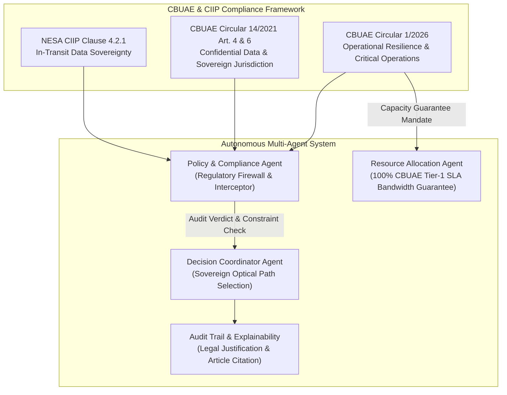

# 01 - UAE Banking Regulations (CBUAE & Critical Financial Infrastructure)

This directory houses official regulatory instruments, standards, and policy frameworks issued by the **Central Bank of the United Arab Emirates (CBUAE)** and the **UAE Supreme Council for National Security / National Electronic Security Authority (NESA)**. These documents establish binding legal requirements for financial operational resilience, critical information infrastructure protection (CIIP), third-party risk management, and sovereign cross-border data transfer safeguards.

---

## 1. Regulatory Authority & Jurisdiction
* **Regulatory Body**: Central Bank of the United Arab Emirates (CBUAE)
* **National Security Authority**: The Supreme Council for National Security / NESA
* **Legal Foundation**: Decretal Federal Law No. (14) of 2018 Regarding the Central Bank & Organization of Financial Institutions and Activities; UAE Federal Cyber Legislation.
* **Jurisdiction**: Licensed Financial Institutions (LFIs), payment system operators, and designated Critical National Financial Infrastructure across the UAE.

---

## 2. Document Inventory & Classification

| Document Filename | Official Title & Issuance | Issuance Date & Status | Classification / Priority |
| :--- | :--- | :--- | :--- |
| `CBUAE_EN_7267_VER1.pdf` | **CBUAE Operational Risk Management Regulation** (Circular No. 1/2026) | Issued 2026; **Enforceable Sept 14, 2026** | **Tier 1 - Mission Critical** |
| `CBUAE_EN_2267_VER1.pdf` | **CBUAE Outsourcing Regulation for Banks** (Circular No. 14/2021) | Issued 2021; Enforceable | **Tier 1 - Mission Critical** |
| `CBUAE_EN_2327_VER1.pdf` | **CBUAE Outsourcing Standards for Banks** (Notice No. 2327/2021) | Issued 2021; Enforceable | **Tier 1 - Technical Standard** |
| `Critical Information Infrastructure Protection CIIP Policy.pdf` | **Critical Information Infrastructure Protection (CIIP) Policy** | Supreme Council for National Security | **Sovereign Mandate (State Level)** |

---

## 3. Article-by-Article Regulatory Analysis & Key Mandates

### A. CBUAE Operational Risk Management Regulation (Circular No. 1/2026)
This regulation constitutes the primary benchmark for banking operational resilience in the UAE, superseding legacy operational risk frameworks.
* **Article (1) - Definitions**:
  * *Critical Operations*: Essential economic and banking functions whose disruption would compromise financial stability, bank solvency, or systemic liquidity (e.g., UAEFTS real-time gross settlement, retail payment clearing, SWIFT messaging).
  * *Operational Resilience*: The ability of an LFI to deliver critical operations through disruptions by anticipating, preventing, recovering, and adapting to severe operational events.
  * *Severe-but-Plausible Scenarios*: Mandatory resilience testing against catastrophic external disruptions, specifically including physical destruction of telecommunications infrastructure, subsea fiber severed events, and multi-hub outages.
  * *Tolerable Level of Disruption*: The maximum acceptable level of disruption to a critical operation, expressed as strict Recovery Time Objectives (RTO) and Recovery Point Objectives (RPO).
* **Article (3) - Operational Resilience Mandate**:
  * Banks must map all internal and external dependencies required to deliver critical operations, explicitly encompassing telecommunications transmission lines, subsea cable landings, and data transport pathways.
  * LFIs must establish contingency connectivity capable of maintaining critical operations within defined tolerance limits during severe-but-plausible disruption scenarios.
* **Article (8) - ICT & Cybersecurity Management**:
  * Requires end-to-end cryptographic protection (in-transit encryption) for all financial transaction flows.
  * Mandates redundant, physically diverse telecommunications circuits for core banking nodes and dual active-active/active-standby data centers.
* **Article (9) - Incident Management & Notification**:
  * Immediate escalation and notification protocols to CBUAE for major operational outages affecting financial transaction availability.
* **Article (11) - Business Continuity Planning (BCP) & Disaster Recovery**:
  * Obligation to maintain tested disaster recovery routing strategies with automated failover capabilities for national clearing and settlement pipelines.
* **Article (13) - Third-Party Risk Management (TPRM)**:
  * Strict accountability for critical service providers, including international telecommunications carriers, cloud service providers, and consortium transit networks.

### B. CBUAE Outsourcing Regulation for Banks (Circular No. 14/2021)
Governs how banks manage external infrastructure, connectivity providers, and cross-border data transfer.
* **Article (1) - Confidential Data**:
  * Defines customer information, transaction payloads, banking ledger records, and account identifiers as strictly protected Confidential Data.
* **Article (4) - Data Protection**:
  * Banks must protect Confidential Data against unauthorized access, disclosure, interception, or manipulation at all times, including during transport across external telecom carrier networks.
* **Article (5) - Outsourcing Agreements**:
  * Mandatory service level agreements (SLAs), business continuity guarantees, and unobstructed audit rights over connectivity and cloud providers.
* **Article (6) - Outsourcing Outside the UAE (Cross-Border Data Transit)**:
  * **Strict Sovereign Jurisdictional Assessment**: Licensed banks cannot route or process Confidential Data through foreign jurisdictions without evaluating legal, political, and operational risk.
  * **Prohibition on Hostile / High-Risk Corridors**: Data transfer through territories where lawful wiretapping, surveillance, or hostile government interception could compromise banking confidentiality is strictly prohibited. Prior CBUAE non-objection is required for offshore data paths.
* **Article (8) - Non-Objection from CBUAE**:
  * Material changes to critical financial transmission routes require regulatory non-objection or adherence to pre-approved business continuity runbooks.

### C. CBUAE Outsourcing Standards for Banks (2021 Companion)
* Prescribes minimum technical security controls for telecommunications providers servicing LFIs:
  * Dedicated optical channel separation or end-to-end authenticated cryptographic encapsulation.
  * Network boundary monitoring, latency bounds ($< 50 \text{ ms}$ for domestic, strict SLA for international SWIFT links), and zero packet loss guarantees during protection switching.

### D. Critical Information Infrastructure Protection (CIIP) Policy
Issued by the UAE Supreme Council for National Security / NESA.
* **Classification**: Categorizes the Financial and Banking Sector alongside Telecommunications as **Lifeline Critical National Infrastructure (Tier 1 Priority)**.
* **Clause 4.2.1 - In-Transit Data Jurisdiction & Sovereign Route Integrity**:
  * Financial data packets originating in the UAE must not be diverted across unvetted terrestrial border crossings or adversarial jurisdictions.
  * BGP rerouting and optical lambda diversion must remain within sovereign or treaty-allied telecom conduits to prevent deep packet inspection (DPI) and cyber sabotage.

---

## 4. Integration into the Multi-Agent AI System

The multi-agent resilience platform translates these legal and regulatory requirements into deterministic software constraints and verifiable LLM auditing rules:



1. **Policy & Compliance Agent (`policy_agent.py`)**:
   * Evaluates proposed optical and packet reroute plans.
   * Enforces **Article 6 (CBUAE 14/2021)** and **NESA CIIP Clause 4.2.1**: If a proposed terrestrial failover passes through an unapproved or conflict-zone transit node, the Policy Agent issues a **STRICT VIOLATION (Zero-Tolerance)** verdict and immediately blocks execution.
2. **Resource Allocation Agent (`resource_allocation_agent.py`)**:
   * Enforces **CBUAE Circular 1/2026 Article 3**: Classifies banking traffic (UAEFTS, RTGS, SWIFT) as **Tier-1 Critical Financial Infrastructure**, guaranteeing $100\%$ capacity allocation ($50\text{ Gbps}$ intact, $0\text{ Gbps}$ dropped) by preempting lower-tier commercial bandwidth (streaming/social media).
3. **Decision Coordinator (`decision_coordinator.py`) & Audit Trail (`09_Audit_and_Evaluation/`)**:
   * Logs every optical wavelength switch with timestamps, exact regulatory article references, and justification proofs for supervisory review by CBUAE and TDRA auditors.

---

## 5. Vector Store & RAG Ingestion Metadata Schema

When ingested by `05_Knowledge_Base/ingest.py`, chunks from this folder are indexed with the following metadata tags:

```json
{
  "source_org": "Central Bank of the United Arab Emirates (CBUAE) / NESA",
  "category": "CBUAE_Banking",
  "document_code": "CBUAE-CIRC-1-2026 / CBUAE-OUT-2021 / NESA-CIIP-V1",
  "regulatory_priority": "Critical (Tier 1)",
  "compliance_topics": [
    "Operational Resilience",
    "Critical Operations",
    "Severe-but-Plausible Disruption",
    "Cross-Border Data Transit",
    "Confidential Data Protection",
    "Third-Party Risk Management",
    "RTO/RPO Compliance"
  ]
}
```
