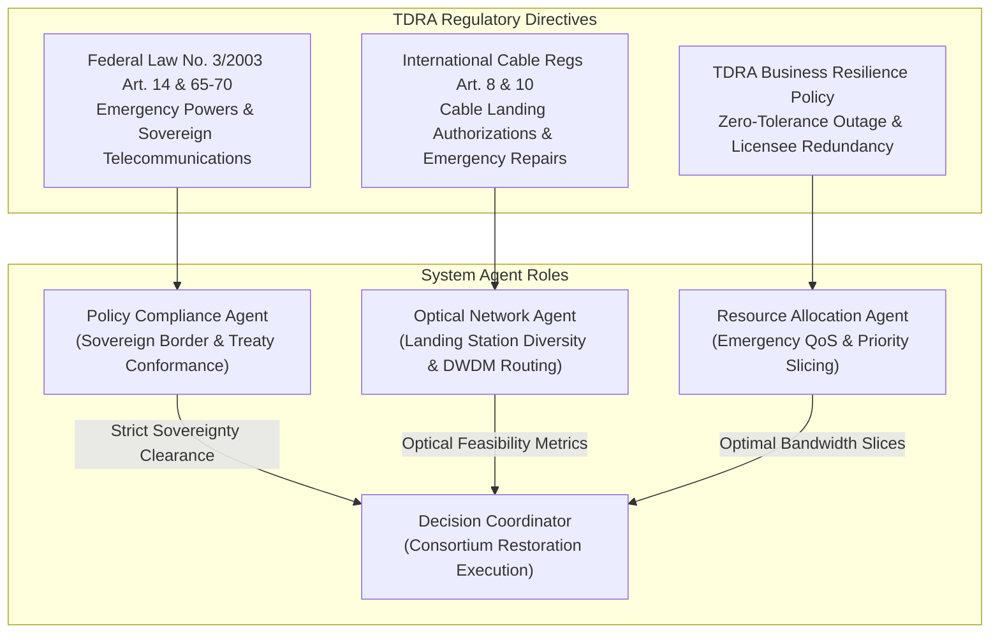

# 02 - UAE Telecommunications Regulations (TDRA)

This directory contains official primary legal statutes, sector-specific regulations, and policy announcements issued by the **Telecommunications and Digital Government Regulatory Authority (TDRA)** of the United Arab Emirates. These instruments define the statutory authority of the telecom regulator, licensing regimes for submarine and terrestrial international cables, national security mandates, and critical infrastructure business continuity obligations.

---

## 1. Regulatory Authority & Legal Mandate
* **Regulatory Body**: Telecommunications and Digital Government Regulatory Authority (TDRA)
* **Governing Legislation**: Federal Law by Decree No. (3) of 2003 Regarding the Organization of the Telecommunications Sector (as amended).
* **Jurisdiction**: All telecommunications licensees (including Emirates Telecommunications Group Company "e&", Emirates Integrated Telecommunications Company "du"), international submarine cable consortia operating within UAE territorial waters and Exclusive Economic Zone (EEZ), and operators of Cable Landing Stations (CLS).

---

## 2. Document Inventory & Classification

| Document Filename | Official Title & Issuance | Issuance Date & Legal Status | Regulatory Scope / Priority |
| :--- | :--- | :--- | :--- |
| `Federal Law by Decree No 3 of 2003 Regarding the Organization of Telecommunications Sector as Amende.pdf` | **UAE Telecommunications Law (Federal Law by Decree No. 3 of 2003 as amended)** | Enacted 2003; continually amended | **Primary Sovereign Statute (Law of the Land)** |
| `International Telecommunications Cable Regulations V10.pdf` | **The International Telecommunications Cable Regulations (Version 1.0)** | TDRA Regulatory Directive | **Mandatory Sector Regulation** |
| `TDRA Business Resilience and Continuity_Regulatory_Announcement.pdf` (+ `.txt` transcript) | **TDRA Regulatory Announcement: Business Resilience and Continuity in the Telecom Sector** | Official TDRA Regulatory Announcement | **Operational Resilience Directive** |
| `Digital Infrastructure and the Digital Economy_Regulatory_Announcement.pdf` (+ `.txt` transcript) | **TDRA Regulatory Announcement: Digital Infrastructure and the Digital Economy** | Strategic Policy Framework | **Digital Economy & Infrastructure Directive** |

---

## 3. Detailed Regulatory Analysis & Key Articles

### A. UAE Telecommunications Law (Federal Law by Decree No. 3 of 2003 as Amended)
Federal Law No. 3 of 2003 is the foundational statute establishing the regulatory framework for telecommunications in the UAE.
* **Article (6) & Article (10) - Authority and Scope**:
  * Establishes TDRA as the competent federal authority to regulate the telecommunications sector, protect national interests, and supervise all telecommunications apparatus, landing stations, and physical transmission media.
* **Article (14) - Regulatory Directives & Public Safety**:
  * Empowers TDRA to issue binding regulations, technical standards, and operational orders to licensees.
  * Directs TDRA to ensure the security, integrity, and uninterrupted availability of telecommunications networks across the Federation.
* **Article (15) & Article (16) - Sovereignty and Public Interest**:
  * Reaffirms state sovereignty over radio frequencies, optical landing conduits, and national cyberspace. Requires telecommunications services to satisfy the strategic requirements of state defense, civil security, and the national economy.
* **Articles (65)–(70) - Emergency Powers & Crisis Mobilization**:
  * In situations of national emergency, catastrophic network failures, or force majeure events, TDRA and state authorities hold the statutory right to mobilize telecommunications networks, mandate priority traffic handling, and requisition alternative transmission capacity to protect critical public services.

### B. International Telecommunications Cable Regulations (Version 1.0)
Specifically regulates the installation, landing, operation, and maintenance of international submarine and terrestrial telecommunications cable systems touching UAE territorial waters or sovereign land.
* **Article (2) - Scope of Application**:
  * Covers every international cable system entering UAE territorial waters (12 nautical miles), internal waters, continental shelf, and EEZ, including connection to Cable Landing Stations (CLS) in Fujairah, Dubai, Abu Dhabi, and Sharjah.
* **Article (3) - Licensing and Authorization**:
  * No party may land or operate an international telecommunications cable without a valid license or explicit authorization from TDRA. Licensees must maintain sovereign control over cable landing facility operations.
* **Article (4) - Marine Surveys and Cable Laying Permits**:
  * All seabed routing, cable laying, and subsea physical works require prior environmental, maritime, and security approvals to safeguard critical coastal waters.
* **Article (8) - Submarine Cable Protection Zones (CPZs)**:
  * Prohibits hazardous maritime activities—including commercial bottom-trawling, dredging, anchoring within designated nautical coordinates, and uncoordinated offshore construction—in the vicinity of subsea cables to eliminate anchor-drag breakage risks.
* **Article (10) - Emergency Maintenance & Repair Operations**:
  * Establishes regulatory procedures for expedited clearance of international cable repair vessels entering UAE territorial waters during emergency outages.
  * Mandates mutual operational assistance and emergency restoration routing among cable consortia and domestic licensees.
* **Article (12) - Network Security and Redundancy**:
  * Requires operators to incorporate physical route diversity, backup terrestrial landing backhauls, and robust operational protection to prevent single-point failures from causing complete regional disconnects.

### C. TDRA Business Resilience and Continuity Announcement
* Mandates that all major telecom licensees implement certified Business Continuity Management Systems (BCMS) compliant with national **NCEMA 7000** and international **ISO 22301** standards.
* Imposes mandatory reporting requirements: Any major disruption severing international connectivity must be formally reported to TDRA's Telecom Operations Centre within strict operational windows.
* Requires continuous resilience drills and scenario simulations (e.g. multi-cable severed incidents in the Red Sea or Arabian Sea).

### D. Digital Infrastructure and the Digital Economy Announcement
* Aligns national optical connectivity with the **UAE Digital Economy Strategy** and the **"We The UAE 2031"** strategic vision.
* Directs operators to invest in intelligent, autonomous optical management technologies (such as ASON and AI-based optical orchestration) to maintain 99.999% availability for critical digital public infrastructure (UAE PASS, FedNet, banking payment gateways).

---

## 4. Multi-Agent System Integration & Enforcement Logic

The TDRA regulatory mandates are directly operationalized within the multi-agent system architecture:



* **Policy & Compliance Agent (`policy_agent.py`)**:
  * Validates routing against **TDRA Article 14.3 (Critical Telecom Infrastructure Sovereignty)**. Rejects any emergency reroute plan that violates UAE territorial routing directives or attempts unverified international transit through hostile geopolitical corridors.
* **Optical Network Agent (`optical_network_agent.py`)**:
  * Evaluates physical cable paths across UAE landing stations (Fujairah CLS on the Indian Ocean coast vs. Dubai/Abu Dhabi CLS on the Arabian Gulf).
  * Implements TDRA cable diversity rules to ensure physical separation of optical channels.
* **Resource Allocation Agent (`resource_allocation_agent.py`)**:
  * Executes TDRA emergency priority mandates: Preserves national vital services (banking, government FedNet, civil protection) during cable cut emergencies by dynamically throttling discretionary commercial bandwidth.

---

## 5. Vector Store Ingestion Metadata Schema

```json
{
  "source_org": "Telecommunications and Digital Government Regulatory Authority (TDRA)",
  "category": "TDRA_Telecom",
  "document_code": "TDRA-LAW-3-2003 / TDRA-CABLE-V10 / TDRA-RESILIENCE-DIR",
  "regulatory_priority": "High (Statutory Requirement)",
  "compliance_topics": [
    "Telecommunications Law",
    "Submarine Cable Regulations",
    "Cable Protection Zones (CPZ)",
    "Emergency Powers",
    "Business Continuity Management",
    "Network Resilience",
    "Sovereign Routing"
  ]
}
```
