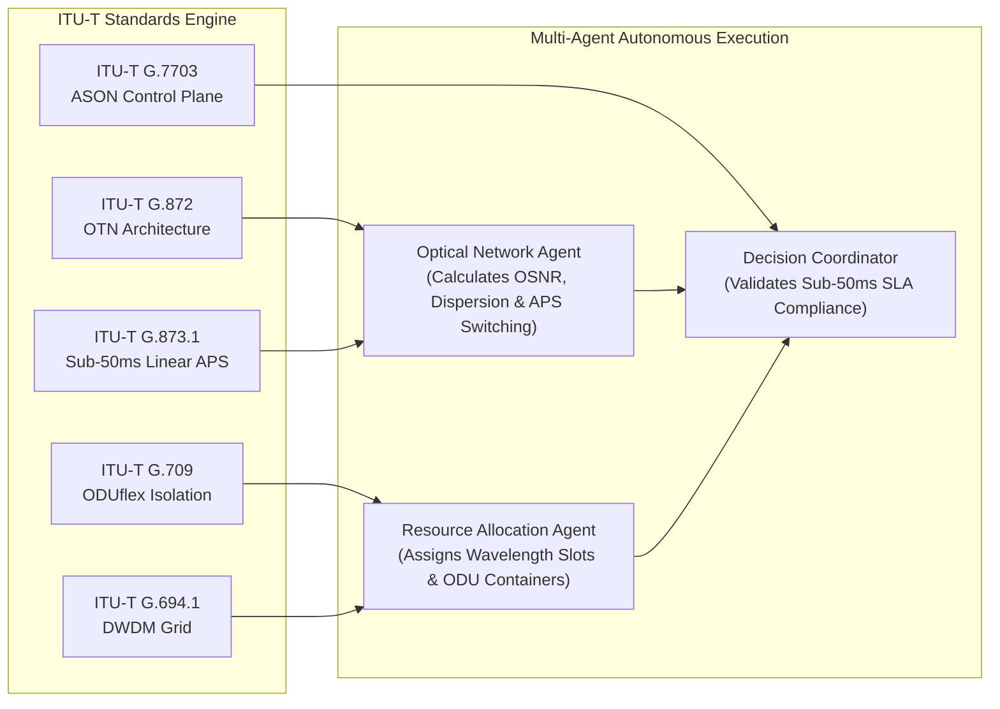

# 03 - ITU-T Optical Transport & Photonic Network Standards

This directory contains official international technical standards issued by the **International Telecommunication Union – Telecommunication Standardization Sector (ITU-T)**, primarily developed by **Study Group 15 (Transport, Access and Home)**. These recommendations establish the physical, architectural, framing, protection, and control plane standards governing modern Optical Transport Networks (OTN), Dense Wavelength Division Multiplexing (DWDM), and Automatically Switched Optical Networks (ASON).

---

## 1. Standardization Body & Scope
* **Standardization Authority**: International Telecommunication Union (ITU) / ITU-T Study Group 15
* **Technical Scope**: Optical transport hierarchy, physical and logical layer survivability, optical wavelength grid allocation, automated control planes, and optical submarine cable terminology.
* **Role in AI System**: Provides the technical rules and physical constraints used by the **Optical Network Technical Agent** and **Resource Allocation Agent** to ensure that automated wavelength re-routing, protection switching, and bandwidth slicing are mathematically, physically, and standard-compliant.

---

## 2. Standards Inventory & Technical Taxonomy

| Standard Code & Edition | Full Standard Title | Status & Release Date | Technical Domain |
| :--- | :--- | :--- | :--- |
| `T-REC-G.709-202507-I!Amd4!PDF-E.pdf` | **ITU-T Recommendation G.709 / Y.1331 Amd. 4** | **Published July 2025** (Latest Amd. 4) | **OTN Framing, Interfaces & FlexO** |
| `T-REC-G.872-202403-I!!PDF-E.pdf` | **ITU-T Recommendation G.872** | **Published March 2024** | **Optical Transport Network Architecture** |
| `T-REC-G.873.1-202003-I!Cor1!PDF-E.pdf` | **ITU-T Recommendation G.873.1 Cor. 1** | Published March 2020 | **Linear Protection Switching (< 50ms)** |
| `T-REC-G.7703-202105-I!!PDF-E.pdf` | **ITU-T Recommendation G.7703** | Published May 2021 | **ASON Architecture (Dynamic Control Plane)** |
| `T-REC-G.7703-202211-I!Amd1!PDF-E.pdf` | **ITU-T Recommendation G.7703 Amd. 1** | Published Nov 2022 | **ASON Control Architecture Amendment 1** |
| `T-REC-G.7703-202408-I!Amd2!PDF-E.pdf` | **ITU-T Recommendation G.7703 Amd. 2** | **Published August 2024** | **ASON Control Architecture Amendment 2** |
| `T-REC-G.972-202408-I!!PDF-E.pdf` | **ITU-T Recommendation G.972** | **Published August 2024** | **Submarine Optical Terminology & Taxonomy** |
| `T-REC-G.694.1-202010-I!!PDF-E.pdf` | **ITU-T Recommendation G.694.1** | Published October 2020 | **DWDM Spectral Grids & Frequency Spacing** |

---

## 3. Deep Technical Analysis of Standards

### A. ITU-T G.709 / Y.1331 Amd. 4 (July 2025): OTN Interfaces & Framing
ITU-T G.709 is the foundational international standard defining how data is framed, multiplexed, and transported across multi-terabit optical fiber networks.
* **Optical Transport Hierarchy (OTH)**: Defines Optical Transport Units (OTU1, OTU2, OTU3, OTU4, and beyond 100G / B100G) and Flexible Optical Transport (FlexO) interfaces.
* **ODU Containers & Granular Bandwidth Isolation**:
  * Specifies Optical Channel Data Units (ODU0, ODU1, ODU2, ODU3, ODU4, and ODUflex).
  * ODUflex enables bit-rate agile bandwidth provisioning, allowing the AI system to slice transport bandwidth with exact bit-level reservation.
  * Guarantees non-blocking, isolated cryptographic transmission for critical banking channels (SWIFT/RTGS) separate from commodity consumer traffic.
* **Forward Error Correction (FEC)**: Standardizes Reed-Solomon RS(255,239) and modern Staircase / Soft-Decision FEC (SD-FEC) to correct transmission errors over ultra-long submarine optical spans without requiring re-transmissions.

### B. ITU-T G.872 (March 2024): Architecture of Optical Transport Networks
Defines the architectural decomposition and survivability framework of photonic transport networks.
* **Layer Network Modeling**:
  * Decomposes the optical network into distinct structural layers: Optical Transmission Section (OTS), Optical Multiplex Section (OMS), Optical Channel (OCh), and Optical Tributary Signal (OTSi).
* **Photonic Switching & ROADM Nodes**:
  * Models Reconfigurable Optical Add-Drop Multiplexers (ROADM) operating in colorless, directionless, and contentionless (CDC) configurations.
  * Details optical subnetwork connections (SNC) and client signal adaptation.
* **Survivability Framework**:
  * Establishes the clear architectural separation between optical layer protection (sub-wavelength and optical channel switching) and higher-layer digital/packet restoration, ensuring cross-layer orchestration without route oscillation.

### C. ITU-T G.873.1 Cor. 1 (March 2020): Linear Protection Switching
Specifies the mathematical protocol and state machine for linear protection switching across optical transport networks.
* **1+1 and 1:n Protection Switching**:
  * *1+1 Dedicated Protection*: The source client traffic is concurrently bridged to both a primary (working) optical trail and a physically diverse secondary (protection) optical trail. The receiver continuously selects the signal with the superior optical signal quality.
  * *1:n Shared Protection*: A single standby optical trail protects $n$ working trails, utilized for lower-priority enterprise services.
* **Sub-50ms Protection Switching Target**:
  * Standardizes the Automatic Protection Switching (APS) protocol signaling over the OTN overhead bytes (K1/K2 bytes).
  * Enforces the global carrier requirement: Autonomous optical trail protection switching must complete in **under 50 milliseconds** ($\tau \le 50\text{ ms}$) following fiber disruption, preventing TCP session timeouts and financial transaction aborts.

### D. ITU-T G.7703 + Amd. 1 & 2 (2021–2024): ASON Control Architecture
Specifies the Automatically Switched Optical Network (ASON) control plane architecture.
* **Separation of Planes**: Completely decouples the Transport Plane (photonic switches, optical fibers), the Management Plane (OSS/NMS), and the Control Plane (distributed signaling, routing controllers).
* **Call and Connection Separation**: Allows an AI agent or software orchestrator to initiate, modify, or release optical connections dynamically across diverse carrier domains.
* **Dynamic Route Computation**: Supports dynamic optical routing based on optical physical constraints (chromatic dispersion, polarization mode dispersion, optical signal-to-noise ratio / OSNR) and administrative policies.

### E. ITU-T G.972 (August 2024): Submarine Cable System Terminology
Establishes unambiguous international engineering definitions for submarine optical infrastructure:
* Standardizes terms for Submerged Plant (cables, repeaters, equalizers, branching units / BU), Terminal Transmission Equipment (TTE), Cable Landing Stations (CLS), and Power Feed Equipment (PFE).
* Ensures consistent semantic taxonomy across our multi-agent prompts, RAG vector embeddings, and audit log generation.

### F. ITU-T G.694.1 (October 2020): DWDM Spectral Grids
Defines the absolute physical frequencies for Dense Wavelength Division Multiplexing.
* **Anchor Point**: Frequency grid is formally anchored at **193.1 THz** ($1552.52\text{ nm}$).
* **Channel Spacings**: Standardizes channel spacings of $100\text{ GHz}$, $50\text{ GHz}$, $25\text{ GHz}$, and $12.5\text{ GHz}$.
* **Flexible Grid**: Defines frequency slot widths of $12.5\text{ GHz} \times m$ and slot centers of $n \times 6.25\text{ GHz}$, allowing our **Resource Allocation Agent** to dynamically allocate dedicated optical spectrum ($\lambda_1 = 1550.12\text{ nm}$) to mission-critical banking payloads.

---

## 4. Multi-Agent Technical Implementation



* **Optical Network Agent (`optical_network_agent.py`)**:
  * Implements **ITU-T G.873.1** sub-50ms switching rules for subsea cable cut events.
  * Validates optical power budgets ($-2.4\text{ dBm}$ optimal power) and verifies chromatic dispersion tolerances along secondary subsea routes (e.g. GCX Falcon South vs. SEA-ME-WE-5).
* **Resource Allocation Agent (`resource_allocation_agent.py`)**:
  * Uses **ITU-T G.694.1** DWDM frequency allocations to assign dedicated optical lambdas ($\lambda_1, \lambda_2$) for CBUAE Tier-1 traffic and maps bandwidth into **ITU-T G.709** ODUflex containers.

---

## 5. Vector Database Ingestion Metadata Schema

```json
{
  "source_org": "International Telecommunication Union (ITU-T Study Group 15)",
  "category": "ITU_T_Optical",
  "document_code": "ITU-T G.709 (2025) / G.872 (2024) / G.873.1 (2020) / G.7703 (2024) / G.972 (2024) / G.694.1 (2020)",
  "regulatory_priority": "High (International Engineering Standard)",
  "compliance_topics": [
    "Optical Transport Network (OTN)",
    "Dense Wavelength Division Multiplexing (DWDM)",
    "Linear Protection Switching (APS)",
    "Automatically Switched Optical Network (ASON)",
    "Submarine Optical Fiber Design",
    "ODUflex & FlexO Slicing",
    "Spectral Grid Spacing"
  ]
}
```
