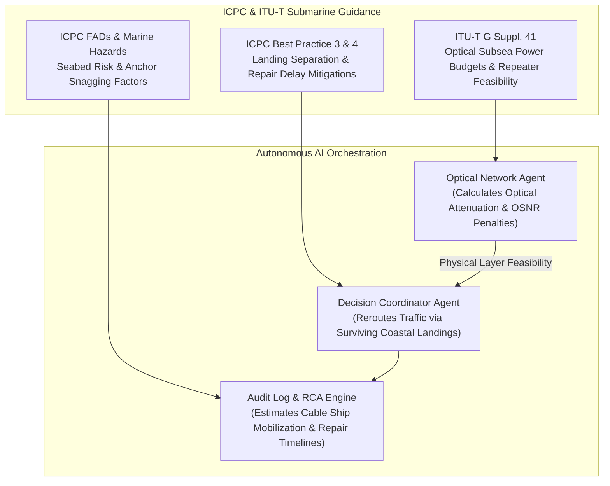

# 04 - Submarine Cable Best Practices & Protection Guidelines

This directory houses international best practices, government policy recommendations, and engineering design guidelines issued by the **International Cable Protection Committee (ICPC)** and the **International Telecommunication Union (ITU-T)**. These documents provide the definitive operational frameworks for protecting submarine telecommunications cables, designating Cable Protection Zones (CPZs), fast-tracking emergency repair permits, mitigating maritime fishing hazards, and engineering resilient subsea optical links.

---

## 1. Issuing Organizations & Global Authority
* **International Cable Protection Committee (ICPC)**: The world’s leading submarine cable protection organization, comprising over 190 commercial operators, consortium leaders, cable ship owners, and government authorities across 70+ countries, representing over 97% of the world’s commercial subsea cable capacity.
* **ITU-T Study Group 15**: United Nations specialized agency for information and communication technologies, setting international optical transmission recommendations.
* **Operational Role in AI System**: Provides geopolitical and maritime protection criteria for the **Policy & Compliance Agent**, **Optical Network Agent**, and **Decision Coordinator Agent** to evaluate seabed safety, calculate repair vessel mobilization lead times, and optimize alternative subsea cable corridors during physical disruption crises.

---

## 2. Document Inventory & Classification

| Document Filename | Issuing Body & Official Title | Edition & Release Date | Operational Scope / Priority |
| :--- | :--- | :--- | :--- |
| `ICPC-Gov't-Best-Practices-for-Cable-Protection--Resilience-Version-1.2-(English).pdf` | **Government Best Practices for Protecting and Promoting Resilience of Submarine Telecommunications Cables** | Version 1.2 | **Global Policy Benchmark** |
| `ICPC_Government_Best_Practices_for_Cable_Protection_Resilience_FADs_Annex-25-July-2021.pdf` | **ICPC Best Practices Annex: Fish Aggregating Devices (FADs) – Risks to Submarine Cable Deployment and Operations** | Published July 25, 2021 | **Maritime Hazard Mitigation** |
| `T-REC-G.Sup41-202407-I!!PDF-E.pdf` | **ITU-T Recommendation G Supplement 41: Design guidelines for optical fibre submarine cable systems** | **Published July 2024** | **Subsea Optical Engineering Guide** |

---

## 3. In-Depth Operational Analysis & Best Practice Mandates

### A. ICPC Government Best Practices for Cable Protection & Resilience (Version 1.2)
This document outlines core strategies recommended for sovereign governments and telecom authorities to safeguard submarine communications infrastructure:
* **Recommendation 1: Formal Critical Infrastructure Designation**:
  * Governments must formally designate submarine telecommunications cables, landing stations, and backhaul arteries as **Critical National Infrastructure (CNI)**.
  * Directs inter-agency coordination between national telecom regulators (such as the UAE TDRA), coast guards, port authorities, and naval commands.
* **Recommendation 2: Cable Protection Zones (CPZs) & Marine Spatial Planning**:
  * Establishes legally protected seabed corridors where anchoring, commercial bottom-trawling, dredging, and deep-sea mining are strictly prohibited.
  * Enforces mandatory charting of subsea cables on official hydrographic nautical navigation charts.
* **Recommendation 3: Fast-Track Emergency Permitting for Cable Ships**:
  * **Repair Lead-Time Mitigation**: Identifies administrative and bureaucratic delays (customs clearances, cabotage restrictions, naval permits) as the primary contributor to prolonged submarine cable outages.
  * Recommends standard 24–48 hour pre-clearance mechanisms for foreign-flagged cable repair ships entering territorial waters and EEZ during declared emergencies.
* **Recommendation 4: Route Diversity and Landing Site Separation**:
  * Urges governments not to concentrate all international cables in a single geographic landing point.
  * In the UAE context, this reinforces the strategic imperative of dual-coast landing: separating Indian Ocean landings (Fujairah CLS) from Arabian Gulf landings (Dubai, Abu Dhabi, Sharjah CLS) to guarantee survivability if one coastal maritime body experiences geopolitical disruption or seismic events.
* **Recommendation 5: Public-Private Information Sharing**:
  * Mandates real-time threat intelligence and automatic identification system (AIS) vessel monitoring data sharing between cable operators and coastal authorities to warn vessels dragging anchor near subsea cable routes.

### B. ICPC FADs Annex: Risks to Submarine Cable Operations (July 2021)
Fish Aggregating Devices (FADs) represent a growing operational hazard to submarine telecommunications infrastructure:
* **Hazard Characterization**:
  * Drifting and anchored FADs deployed by commercial and artisanal fishing fleets utilize heavy concrete mooring anchors, high-tensile mooring ropes, and synthetic subsurface aggregators that drift and wrap around seabed optical cables.
  * Anchor-drag and entanglement incidents cause mechanical fiber pinching, micro-bending optical power attenuation, and complete shear breaks.
* **Mitigation Protocols**:
  * Recommends maritime exclusion perimeters around subsea cable corridors, mandatory tracking of anchored fishing gear, and rapid acoustic seabed inspection protocols following physical anomalies.

### C. ITU-T Recommendation G Supplement 41 (July 2024): Submarine Cable Design Guidelines
Published in July 2024 by ITU-T SG15, this technical supplement provides modern engineering methodologies for submarine optical systems:
* **Repeatered vs. Unrepeatered System Engineering**:
  * Formulates optical power budgets, link attenuation margins, and Optical Signal-to-Noise Ratio (OSNR) thresholds for multi-span trans-oceanic cables vs. regional coastal festoons.
* **Non-Linearities and Dispersion Management**:
  * Details compensation techniques for Self-Phase Modulation (SPM), Cross-Phase Modulation (XPM), Four-Wave Mixing (FWM), and Polarization Mode Dispersion (PMD) in high-capacity coherent subsea systems.
* **Terminal Transmission Equipment (TTE) & Branching Units (BU)**:
  * Details optical add-drop branching units (ROADM BU) that allow optical lambdas to be split between multiple regional landing stations (e.g. dropping UAE traffic at Fujairah while passing regional transit traffic to Oman and India).
  * Specifies electrical power feeding equipment (PFE) and single-end feeding emergency modes when a shunt fault or cable cut occurs.

---

## 4. Multi-Agent System Integration & Resilience Modeling

The ICPC best practices and ITU-T G.Sup41 engineering guidelines form the operational baseline for our autonomous system:



1. **Strategic Landing Diversity**:
   * When an anchor cut severs primary cables at Fujairah (Gulf of Oman), the **Decision Coordinator** does not route blindly; it leverages ICPC landing separation principles to immediately pivot traffic to surviving Arabian Gulf cables (e.g., GCX Falcon South landing at Dubai/Abu Dhabi).
2. **Physical Feasibility Verification**:
   * The **Optical Network Agent** applies **ITU-T G.Sup41** formulas to verify that the lengthened alternative subsea route maintains sufficient OSNR and acceptable optical launch power ($-2.4\text{ dBm}$) without requiring additional repeaters.
3. **Audit Trail & Repair Lead Time Calculation**:
   * In compliance with **ICPC Recommendation 3**, the system logs expected repair durations based on cable ship availability, marine permit clearance windows, and consortium restoration agreements.

---

## 5. Vector Database Ingestion Metadata Schema

```json
{
  "source_org": "International Cable Protection Committee (ICPC) / ITU-T",
  "category": "ICPC_Submarine",
  "document_code": "ICPC-GOV-BP-V1.2 / ICPC-FAD-2021 / ITU-T-GSUP41-2024",
  "regulatory_priority": "High (International Best Practice)",
  "compliance_topics": [
    "Submarine Cable Protection",
    "Cable Protection Zones (CPZ)",
    "Repair Ship Expedited Permitting",
    "Landing Diversity",
    "Fish Aggregating Devices Hazard Mitigation",
    "Repeatered Optical Cable Design",
    "Subsea Power Feeding & OSNR Margins"
  ]
}
```
