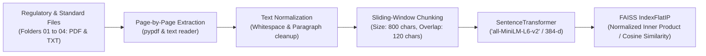

# 05 - Knowledge Base & Vector Store Engine

This directory manages the end-to-end data lifecycle of all regulatory, statutory, and optical engineering documents (from directories `01_UAE_Banking_Regulations`, `02_UAE_Telecom_Regulations`, `03_ITU_T_Optical_Standards`, and `04_Submarine_Cable_Best_Practices`). It extracts text from PDF and TXT documents, performs deterministic chunking with overlap, generates semantic embeddings, and stores them in a high-performance **FAISS (Facebook AI Similarity Search)** vector database.

---

## 1. Directory Structure

```text
05_Knowledge_Base/
│
├── processed_chunks/
│   ├── .gitkeep
│   └── chunks_summary.json     # Complete serialized array of parsed chunks with category & source metadata
│
├── vector_db/
│   ├── .gitkeep
│   ├── index.faiss             # FAISS IndexFlatIP (cosine similarity over normalized 384-d vectors)
│   ├── metadata.pkl            # Pickled chunk texts and metadata records for rapid retrieval
│   └── config.json             # Ingestion hyperparameters and vector dimension registry
│
├── raw_docs/                   # Supplementary and auxiliary reference texts
│   └── .gitkeep
│
├── ingest.py                   # Automated document parser, chunker, and FAISS indexing pipeline
└── README.md                   # This documentation file
```

---

## 2. Ingestion Pipeline & Architecture

The ingestion pipeline (`ingest.py`) implements a structured 5-stage workflow:



### Ingestion Specifications:
* **Embedding Model**: `sentence-transformers/all-MiniLM-L6-v2` (384-dimensional dense vectors, optimized for local inference and regulatory retrieval accuracy).
* **Chunk Size**: $800$ characters with soft word-boundary snapping ($90\%$ threshold).
* **Chunk Overlap**: $120$ characters to preserve contextual continuity across legal articles and mathematical formulas.
* **Minimum Chunk Threshold**: $80$ characters (filters out whitespace artifacts, blank headers, and page numbers).
* **FAISS Index Type**: `IndexFlatIP` (Exact inner product search; when vectors are $L_2$-normalized, inner product equals cosine similarity $\cos(\theta) \in [-1, 1]$).

---

## 3. Ingested Document Matrix

The Knowledge Base indexes documents across four distinct domains:

| Category Key | Source Directory | Primary Institutions | Core Ingested Documents |
| :--- | :--- | :--- | :--- |
| `CBUAE_Banking` | `01_UAE_Banking_Regulations/` | Central Bank of the UAE & NESA | CBUAE Circular 1/2026 (Operational Risk Management), Circular 14/2021 (Outsourcing Regulation), Notice 2327/2021 (Outsourcing Standards), NESA CIIP Policy. |
| `TDRA_Telecom` | `02_UAE_Telecom_Regulations/` | TDRA UAE | Federal Law by Decree No. 3/2003 (as amended), International Telecommunications Cable Regulations V1.0, TDRA Business Resilience & Continuity Announcement, Digital Infrastructure & Digital Economy Announcement. |
| `ITU_T_Optical` | `03_ITU_T_Optical_Standards/` | ITU-T Study Group 15 | ITU-T G.709/Y.1331 Amd. 4 (2025), G.872 (2024), G.873.1 Cor. 1 (2020), G.7703 + Amd. 1/2 (2021-2024), G.972 (2024), G.694.1 (2020). |
| `ICPC_Submarine` | `04_Submarine_Cable_Best_Practices/` | ICPC & ITU-T | ICPC Government Best Practices V1.2, ICPC FADs Annex (2021), ITU-T Recommendation G Supplement 41 (2024). |

---

## 4. Execution & Maintenance

To re-index all regulatory documents and rebuild the FAISS vector database:

```bash
# Execute from the Telecom_Resilience_AI root directory
py 05_Knowledge_Base/ingest.py
```

Upon execution, the script:
1. Iterates across folders `01` to `04` and extracts text from all `.pdf`, `.txt`, and `.md` files (excluding instructional `README.md` files).
2. Computes embeddings using PyTorch (`cuda` if GPU available, fallback to multi-threaded `cpu`).
3. Writes the updated index to `vector_db/index.faiss` and metadata to `vector_db/metadata.pkl`.
4. Saves a transparent, human-readable audit record of all text chunks in `processed_chunks/chunks_summary.json`.
